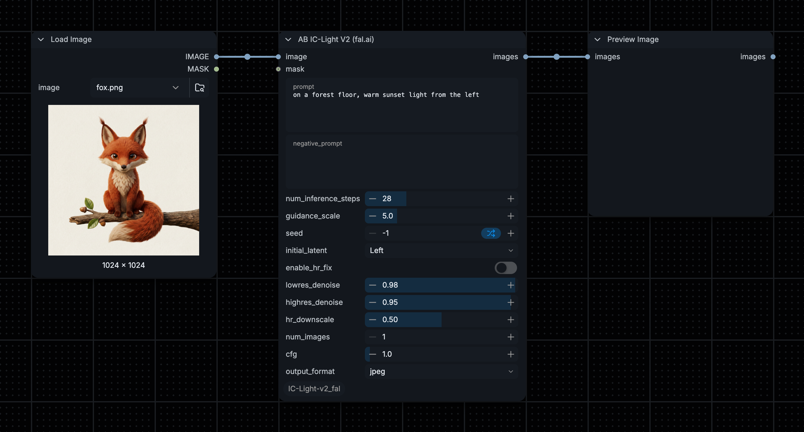

<div align="center">

# AB IC-Light V2 (fal.ai): relight photos and swap backgrounds in ComfyUI

**Describe the light and the place, get your subject relit to match; IC-Light V2 runs on fal.ai, no local GPU needed.**

<br />

[](https://github.com/a-und-b/ComfyUI_IC-Light-v2_fal/stargazers)
&nbsp;
[](https://registry.comfy.org/nodes/ComfyUI_IC-Light-v2_fal)
&nbsp;
[](https://registry.comfy.org/nodes/ComfyUI_IC-Light-v2_fal)
&nbsp;
[](LICENSE)

<br />



---

A cut-out subject pasted onto a new background never looks right: the light on the subject comes from somewhere else. [lllyasviel's IC-Light V2](https://github.com/lllyasviel/IC-Light/discussions/98) relights the subject to the scene you describe. This node sends your image to the [fal.ai API](https://fal.ai/models/fal-ai/iclight-v2/api) and returns the result as a ComfyUI image.

[Install](#install) · [Example workflow](#example-workflow) · [Parameters](#parameters) · [Contributing](#contributing)

</div>

---

## Why AB IC-Light V2 (fal.ai)

Running IC-Light V2 locally needs a large GPU and its own model setup. Here it is one node and a fal.ai key. The node makes network calls by design: it uploads the image (and mask) to fal.ai and downloads the result. fal.ai bills every image; see their pricing before you queue batches. Dependencies: `fal-client`, `requests`, `pillow`.

## Features

| You want | You use |
|----------|---------|
| New light and background from a description | `prompt`, e.g. `at the beach, golden hour` |
| Light from one side | `initial_latent`: `Left`, `Right`, `Top`, `Bottom` |
| Only part of the image relit | an optional `mask` |
| More detail | `enable_hr_fix` with `highres_denoise` and `hr_downscale` |
| Several variants in one request | `num_images` (1–4) |

## Install

**ComfyUI Manager:** search for **AB IC-Light V2**, install, set your API key (below), restart ComfyUI.

**comfy-cli:**

```bash
comfy node install ComfyUI_IC-Light-v2_fal
```

**Manually:**

```bash
cd ComfyUI/custom_nodes
git clone https://github.com/a-und-b/ComfyUI_IC-Light-v2_fal.git
pip install -r ComfyUI_IC-Light-v2_fal/requirements.txt
```

Restart ComfyUI. The node appears under **AB/Image**; search for `AB IC-Light` or `relight`.

### API key

Set your [fal.ai API key](https://fal.ai/dashboard/keys) as an environment variable before starting ComfyUI:

```bash
export FAL_KEY=your_fal_key
```

Existing `config.ini` setups (`[falai] api_key=…`) still work; `FAL_KEY` wins when both are set.

## Example workflow

[`ab-ic-light-relight-on-fal.json`](example_workflows/ab-ic-light-relight-on-fal.json): **Load Image** → **AB IC-Light V2 (fal.ai)** → **Preview Image**, core nodes only. Drag the file onto the canvas, or open it in ComfyUI under Workflow → Browse Templates, under the pack's name. Pick your image in **Load Image** and queue: each run is one paid fal.ai request. The preview above shows the graph before a run.

For best results, remove the background first (any background-removal node) and connect the subject's mask to `mask`.

## Parameters

- `image`: the subject to relight
- `prompt`: the light and background you want
- `negative_prompt`: what the result should not show
- `num_inference_steps`: more steps, more detail, slower
- `guidance_scale`: how closely the result follows the prompt
- `seed`: `-1` lets fal.ai pick a random seed
- `initial_latent`: side the light comes from (`None`, `Left`, `Right`, `Top`, `Bottom`)
- `enable_hr_fix`: second pass at higher resolution
- `lowres_denoise`: denoise strength of the low-resolution pass
- `highres_denoise`: denoise strength of the high-resolution pass (with `enable_hr_fix`)
- `hr_downscale`: scale of the low-resolution pass (with `enable_hr_fix`)
- `num_images`: images per run, each billed by fal.ai
- `cfg`: real CFG scale, 1.0 is the fal.ai default
- `output_format`: `jpeg` or `png`
- `mask` (optional): area to relight

Up to 0.1.x the node was called *IC-Light V2 (fal.ai)* under *image effects/lighting*. Search still finds the old name, and saved workflows load unchanged.

## Contributing

Bug reports and pull requests are welcome. Open an [issue](https://github.com/a-und-b/ComfyUI_IC-Light-v2_fal/issues) first for larger changes; [`CONTRIBUTING.md`](CONTRIBUTING.md) has the three steps.

## License

[MIT](LICENSE)

## Credits

- lllyasviel for the [IC-Light model](https://github.com/lllyasviel/IC-Light)
- fal.ai for the [API endpoint](https://fal.ai/models/fal-ai/iclight-v2/api)

---

<div align="center">

Built by [Holger Will](https://github.com/a-und-b) at [anders & besser](https://andersundbesser.de)

<br />

[](https://github.com/a-und-b/ComfyUI_IC-Light-v2_fal/stargazers)

</div>
